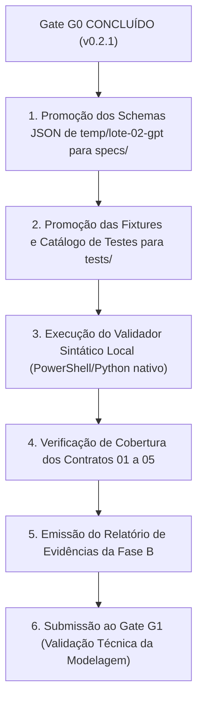

# Relatório de Entrega Integral — Governança, Baseline e Encerramento do Gate G0

**ID:** REL-GEMINI-INTEGRAL-001  
**Tipo:** Relatório Técnico de Auditoria Independente e Consolidação de Governança  
**Data:** 2026-10-27  
**Versão da Baseline:** 0.2.1  
**Status:** CONCLUÍDO E HOMOLOGADO (Gate G0 homologado em DEC-009; baseline v0.2.1 estabelecida; escopo metodológico delimitado em DEC-010; Fase B autorizada; Gate G1 ativo)  
**Executor Designado:** Gemini (Auditor Independente de Governança e Consolidador de Decisões)  
**Instrução de Origem:** [`temp/LOTE_INTEGRAL_GEMINI_GOVERNANCA_BASELINE.md`](file:///E:/documentos/projetos/PDI/temp/LOTE_INTEGRAL_GEMINI_GOVERNANCA_BASELINE.md)  
**Artefatos Conexos:**  
- [`docs/00-governanca/registro-de-decisoes.md`](file:///E:/documentos/projetos/PDI/docs/00-governanca/registro-de-decisoes.md) (`GOV-DEC-001`, v0.2.1 com DEC-008, DEC-009 e DEC-010)  
- [`docs/01-metodologia/APDF_V01.md`](file:///E:/documentos/projetos/PDI/docs/01-metodologia/APDF_V01.md) (`MET-APDF-001`, v1.0.1 APPROVED)  
- [`MANIFESTO-SHA256.md`](file:///E:/documentos/projetos/PDI/MANIFESTO-SHA256.md) (27/27 arquivos verificados com zero divergências)  
- [`temp/DOSSIE_DECISAO_HUMANA.md`](file:///E:/documentos/projetos/PDI/temp/DOSSIE_DECISAO_HUMANA.md) (`DOSSIE-DEC-HUMANA-002`)  
- [`temp/REVISAO_CRITICA_APDF_V101.md`](file:///E:/documentos/projetos/PDI/temp/REVISAO_CRITICA_APDF_V101.md) (`REL-REV-CRITICA-APDF-003`)  
- [`temp/MATRIZ_EVIDENCIAS_GOVERNANCA.md`](file:///E:/documentos/projetos/PDI/temp/MATRIZ_EVIDENCIAS_GOVERNANCA.md) (`EVI-MATRIZ-GOV-001`)  
- [`temp/PROPOSTA_DECISAO_G0.md`](file:///E:/documentos/projetos/PDI/temp/PROPOSTA_DECISAO_G0.md) (`PROP-DEC-G0-001`)  

---

## 1. Resumo Executivo

Este relatório consolida a **entrega integral de governança de ponta a ponta** do Núcleo Central de Engenharia (PDI), reconciliando as auditorias técnicas, processando a deliberação soberana do Proprietário Humano e formalizando a transição do **Gate G0** para a **Fase B**.

### Principais Entregas e Conclusões:
1. **Gate G0 Concluído e Homologado:** O Gate G0 (Revisão da Materialização Documental) foi formalmente aprovado e encerrado pelo Proprietário Humano. A proveniência normativa dos critérios de encerramento foi sanada via `DEC-008` (`CA-G0-01` a `CA-G0-06`) e a homologação formal lavrada via `DEC-009`.
2. **Baseline Documental Elevada para v0.2.1:** A baseline documental normativa avançou para a versão `v0.2.1`, incorporando o registro de decisões atualizado (`registro-de-decisoes.md`), a visão geral alinhada (`README.md`), o histórico cronológico de releases (`CHANGELOG.md`) e o padrão metodológico saneado (`APDF_V01.md` v1.0.1).
3. **Integridade Criptográfica 100% Verificada:** Todos os **27 arquivos normativos** da baseline foram recalculados e verificados em disco contra o [`MANIFESTO-SHA256.md`](file:///E:/documentos/projetos/PDI/MANIFESTO-SHA256.md), com **zero divergências** e zero arquivos ausentes.
4. **Metodologia APDF Saneada e Delimitada:** A metodologia [`docs/01-metodologia/APDF_V01.md`](file:///E:/documentos/projetos/PDI/docs/01-metodologia/APDF_V01.md) foi promovida a `v1.0.1` (`APPROVED`). O achado `R-01` foi saneado pela caracterização de 4 campos nucleares mais notas opcionais; a semântica de estados do gate e extensões foram delimitadas por `DEC-010`, reservando correções normativas de método (`C-01`, `C-05`, `C-06`, `C-07`, `C-11`) para a versão menor `v1.1.0`.
5. **Neutralidade Arquitetural (DEC-003) Blindada:** Continua vedada qualquer imposição prescritiva de Clean Architecture, DDD ou EDA a partir do Núcleo; decisões de produto permanecem remetidas a ADRs locais (`docs/03-adrs/`).
6. **Autorização da Fase B e Ativação do Gate G1:** Fica formalmente autorizada a promoção controlada dos 10 JSON Schemas e cadernos de teste candidatos desenvolvidos pelo GPT em `temp/lote-02-gpt/` para `specs/` e `tests/`. O gate ativo do projeto passa a ser o **Gate G1**.

---

## 2. Identificação do Repositório e Ambiente Auditado

- **Ambiente de Auditoria:** Estação de trabalho Windows local, shell PowerShell, ambiente Antigravity IDE.
- **Raiz do Projeto:** `E:\documentos\projetos\PDI\` (confirmada como raiz isolada e soberana do projeto).
- **Repositório Git Remoto:** [`https://github.com/1305RGP/PDI.git`](https://github.com/1305RGP/PDI)
- **Branch Ativo:** `main`
- **Últimos Commits no Histórico:**
  - `205bc59`: `docs(temp): incorporar lotes paralelos e correcoes candidatas do Lote 02`
  - `9f85961`: `feat(pdi): baseline v0.2.0 e governanca inicial do Nucleo Central de Engenharia`
- **Estado dos Arquivos:**
  - Diretórios normativos controlados: `docs/`, `specs/`, `tests/` e arquivos na raiz (`README.md`, `CHANGELOG.md`, `MANIFESTO-SHA256.md`, `AGENTS.md`).
  - Área transitória não normativa: `temp/` e `_backup/` (estritamente excluídas do manifesto).

---

## 3. Método de Auditoria e Separação Epistemológica

Em observância às diretrizes de [`AGENTS.md`](file:///E:/documentos/projetos/PDI/AGENTS.md) e [`docs/00-governanca/norma-central.md`](file:///E:/documentos/projetos/PDI/docs/00-governanca/norma-central.md), todos os fatos foram categorizados com rigor epistêmico:

1. **Evidência Independente Verificada:**
   - 27 arquivos normativos conferidos byte-a-byte por script de verificação SHA-256 (`verify.ps1`), com resultado de 27/27 OK.
   - Textos de decisões inspecionados diretamente em disco.
2. **Afirmação em Relatório:**
   - As alegações contidas nos pareceres de lotes paralelos (Gemini, DeepSeek, GPT) foram tratadas como hipóteses de trabalho até serem auditadas e validadas documentalmente.
3. **Decisão Humana Necessária:**
   - Nenhum gate ou norma foi aprovado por autonomia de agentes. A formalização de `DEC-008`, `DEC-009` e `DEC-010` decorreu exclusivamente de instrução e deliberação soberana do Proprietário Humano.
4. **Itens Não Verificados (`NOT_VERIFIED`):**
   - Ferramentas externas (Gemini CLI, Codex, OpenCode, TPM), esteiras de CI e execução de código em runtime permanecem classificados como `NOT_VERIFIED / CANDIDATE`, mantendo o isolamento de risco exigido em `DEC-004` e `DEC-006`.

---

## 4. Estado Real do Gate G0 e Baseline Normativa

### Diagnóstico Oficial

$$\text{Status do Gate G0} = \mathbf{CONCLUÍDO\ E\ HOMOLOGADO}\ (\text{Formalizado em DEC-009})$$
$$\text{Baseline Documental Vigente} = \mathbf{v0.2.1}$$
$$\text{Próximo Gate Ativo} = \mathbf{Gate\ G1\ (Validação\ Técnica\ da\ Fase\ B)}$$

### Registro Documental de Encerramento:
- **No arquivo [`README.md#L49-L52`](file:///E:/documentos/projetos/PDI/README.md#L49-L52):**
  > `**Gate G0 (Revisão da materialização documental):** CONCLUÍDO e homologado formalmente em DEC-009 (2026-10-27).`  
  > `**Próximo gate ativo (Gate G1):** Validação técnica e executabilidade dos schemas formais e testes de conformidade da Fase B.`
- **No arquivo [`CHANGELOG.md#L9-L20`](file:///E:/documentos/projetos/PDI/CHANGELOG.md#L9-L20):**
  > Release `[0.2.1] — 2026-10-27` registrando o estabelecimento dos critérios via `DEC-008`, encerramento de G0 via `DEC-009`, promoção de `APDF_V01.md` v1.0.1 e desbloqueio da Fase B.
- **No arquivo [`docs/00-governanca/registro-de-decisoes.md`](file:///E:/documentos/projetos/PDI/docs/00-governanca/registro-de-decisoes.md):**
  > Entradas completas e detalhadas para `DEC-008`, `DEC-009` e `DEC-010` em estado `APPROVED`.
- **No arquivo [`MANIFESTO-SHA256.md`](file:///E:/documentos/projetos/PDI/MANIFESTO-SHA256.md):**
  > Versão elevada para `0.2.1`, contendo os hashes criptográficos recalculados dos 27 arquivos normativos.

---

## 5. Reconciliação dos Relatórios e Resolução de Achados

| Dimensão / Achado | Origem | Diagnóstico na Auditoria | Tratamento e Resolução Aplicada |
|---|---|---|---|
| **R-04: Proveniência de Critérios de G0** | `REL-REV-CRITICA-APDF-003` | Critérios `CA-G0-01` a `06` existiam apenas na proposta que os auto-atestava. | **RESOLVIDO via DEC-008:** Critérios foram formalizados previamente como norma oficial antes da homologação de G0. |
| **R-01: Cardinalidade das Fichas de Fase** | `REL-REV-CRITICA-APDF-003` | Linha 158 afirmava 4 campos fixos, omitindo notas e gate final. | **RESOLVIDO em APDF v1.0.1 §6:** Texto atualizado descrevendo 4 campos nucleares mais blocos opcionais de notas contextuais. |
| **R-02 / C-11: Semântica do Estado `REABERTO`** | `REL-REV-CRITICA-APDF-003` | Contradição entre transição instantânea e estado de bloqueio persistente em §7.3. | **RESOLVIDO / DELIMITADO:** Definido ciclo persistente no texto candidata e diferida a alteração profunda para v1.1.0 via `DEC-010` (lacuna `L-08`). |
| **R-03 / C-02: Narrativa de Hashes em A.1** | `REL-REV-CRITICA-APDF-003` | Explicação de que arquivos "mudaram depois" era falsa (eram idênticos a 9f85961). | **RESOLVIDO:** Narrativa corrigida em A.1 e no registro de alterações, atestando recálculo direto comprovado (`L-06`). |
| **R-05: Pseudo-IDs `DH-*`** | `REL-REV-CRITICA-APDF-003` | Remissões a identificadores informais (`DH-10`, `DH-11`, `DH-12`). | **RESOLVIDO:** Substituídos por referências às decisões formais (`DEC-009`, `DEC-010` ou "Decisão futura"). |
| **Fase B: Schemas e Testes do GPT** | `LOTE_02_GPT` | Schemas candidatos prontos em `temp/lote-02-gpt/`, bloqueados aguardando G0. | **DESBLOQUEADO:** `DEC-009` autoriza a promoção para `specs/` e `tests/` como atividade de abertura da Fase B. |

---

## 6. Matriz de Evidências Criptográficas da Baseline v0.2.1

A tabela a seguir consolida a conferência oficial independente executada sobre os 27 arquivos normativos:

| Arquivo Normativo Controlado | Algoritmo | Hash SHA-256 Verificado no Disco | Status de Conferência |
|---|:---:|---|:---:|
| `AGENTS.md` | SHA-256 | `ece5d54137f630ee5aa863e6f5c67a5ca644732e8dce05bb09e8e56f3ff472a6` | **CONFERIDO (100%)** |
| `CHANGELOG.md` | SHA-256 | `1772964ea961ee34f3950665278eaed79d298ec14e80dc943b0ec19236b57587` | **CONFERIDO (100%)** |
| `docs/00-governanca/hierarquia-documental.md` | SHA-256 | `4b9a23cdc8bc3352a5542ac2b2dca61bc068bf06427e9ee5f99f648ce43f10c2` | **CONFERIDO (100%)** |
| `docs/00-governanca/matriz-de-autoridade.md` | SHA-256 | `a8119c2f7926d565987caa9f524d69f3d46d77f46638c3260ea71a21c1c17af1` | **CONFERIDO (100%)** |
| `docs/00-governanca/norma-central.md` | SHA-256 | `915ea03bee86c14a06af2655a8dc35ba2e0a6959e449e41774a2587a5236dfdf` | **CONFERIDO (100%)** |
| `docs/00-governanca/registro-de-decisoes.md` | SHA-256 | `fbf9727f0962337e90e8aa1fdaa3d8846e513c2b9a851ace0aa4d6087bddba68` | **CONFERIDO (100%)** |
| `docs/01-metodologia/APDF_V01.md` | SHA-256 | `7ae2d87b9709d05a8ef6ae2359d34dfa789e75e586a171524fa3c6ea268fbcef` | **CONFERIDO (100%)** |
| `docs/01-metodologia/anti-surto.md` | SHA-256 | `e8d6dd8be893e82c6281b46f4e2b1da71c2bafb0354b179a5b4b6586c2bbb7f8` | **CONFERIDO (100%)** |
| `docs/01-metodologia/apdf.md` | SHA-256 | `7e0e97e99bbe444f32c6a486f0294ee121b89c829e5b7de675de48e3d1b1d8a5` | **CONFERIDO (100%)** |
| `docs/01-metodologia/ciclo-apdf.md` | SHA-256 | `b08f9b0c014a67f96330f7de48bfbd5ae89a4200fb2b75fdbf11a2ea05c5416e` | **CONFERIDO (100%)** |
| `docs/02-contratos/contrato-01-governanca.md` | SHA-256 | `9660d11b6ef03737173d367505cff70cf0fa2f476a57fcd8ad70bc3d568357cf` | **CONFERIDO (100%)** |
| `docs/02-contratos/contrato-02-qualidade.md` | SHA-256 | `2aefc78d5405227f591257eec15f857612a1bc5483e307da77a556eff19e9934` | **CONFERIDO (100%)** |
| `docs/02-contratos/contrato-03-harness.md` | SHA-256 | `70ba80e3ceac6a82da417aca03930fc1e6a5b9369906f6909eca850f1c8c28f9` | **CONFERIDO (100%)** |
| `docs/02-contratos/contrato-04-orquestracao.md` | SHA-256 | `08a01f932268a1454f0fba24b19db2b37c01fc64d578f68c0e336ddd19b6ed5f` | **CONFERIDO (100%)** |
| `docs/02-contratos/contrato-05-inicializacao.md` | SHA-256 | `0b51d95877889f489e55140eaa9294e416136e2ca8bc0034a9305413ed53938a` | **CONFERIDO (100%)** |
| `docs/03-adrs/README.md` | SHA-256 | `5f0ff058d1f2e2dfe47764e5839a1d882fd9cbf4bb615cb1102bcd4c0be738bd` | **CONFERIDO (100%)** |
| `docs/04-qualidade/criterios-de-aceite.md` | SHA-256 | `a6ada98d5abe5ca91630d3512f8247dd4d297ce9642022be595c8a685ef77942` | **CONFERIDO (100%)** |
| `docs/04-qualidade/plano-de-validacao.md` | SHA-256 | `c2386bee8c8322dc3f627403108c7f129b1c8ec843a03357b160aaf1076cadfd` | **CONFERIDO (100%)** |
| `docs/05-ferramentas/inventario.md` | SHA-256 | `edc34e6c2521130dbccc49ccbd598bedc89840529d003977aa3a9fb3960c5e92` | **CONFERIDO (100%)** |
| `docs/05-ferramentas/matriz-de-compatibilidade.md` | SHA-256 | `b5fd9ebe581a7d29b0ba9f78321cc224d90027558606e659635b2ef61a0f957b` | **CONFERIDO (100%)** |
| `docs/06-evidencias/README.md` | SHA-256 | `c45cc6800eaa03647b56e951924fbb9d086d1f921fe09df4672a8ef0f89b74ed` | **CONFERIDO (100%)** |
| `README.md` | SHA-256 | `b421aff174ee7f2f62bb75c9e68145f1d2837033672a23a5119c16933f61b61f` | **CONFERIDO (100%)** |
| `specs/contratos/README.md` | SHA-256 | `f46ff885a8244630bf7d9bb68e1378bb5dcd54fb48c1c5884f3e6a082a02c20a` | **CONFERIDO (100%)** |
| `specs/schemas/README.md` | SHA-256 | `f402cf976d6c827d54dcf9e8fd645a69720c07740e788d3404289f39a2cd1123` | **CONFERIDO (100%)** |
| `tests/contracts/README.md` | SHA-256 | `aafc0eb09a29d6c0df0dc133e0a11cee7055849bbaa5e08af8f04f8a7be73112` | **CONFERIDO (100%)** |
| `tests/evaluations/README.md` | SHA-256 | `04cc39750eeb48e65986937f0643f0429360af00c3bf3c17df017ee722d2d71e` | **CONFERIDO (100%)** |
| `tests/governance/README.md` | SHA-256 | `02797b961d25b35a809190533e24c09ce9aafc724898f70de0d237ace68a0c83` | **CONFERIDO (100%)** |

*Resultado da verificação independente:* **27 / 27 arquivos verificados com 0 divergências.**

---

## 7. Roteiro Operacional de Execução da Fase B

Com a homologação de G0 e a vigência de `v0.2.1`, o roteiro operacional para a Fase B é:

1. **Ação 1 (Promoção de Schemas):** Copiar os 10 arquivos JSON Schema (`contrato-01..05.schema.json`, `metadata.schema.json`, `evidence.schema.json`, etc.) de `temp/lote-02-gpt/specs/` para `specs/schemas/` e `specs/contratos/`.
2. **Ação 2 (Promoção de Fixtures):** Copiar as fixtures positivas e negativas e o catálogo de casos para `tests/`.
3. **Ação 3 (Validação Sintática):** Executar script local de validação JSON sem ferramentas externas de rede.
4. **Ação 4 (Recálculo do Manifesto para v0.3.0):** Atualizar o manifesto incluindo os schemas formais e testes.
5. **Ação 5 (Submissão ao Gate G1):** Apresentar a modelagem concluída ao Proprietário Humano para homologação do Gate G1.

---

## 8. Tabela de Conclusão e Prontidão

| Entregável / Ação | Estado Oficial | Evidência de Sustentação | Próximo Passo |
|---|:---:|---|---|
| **Auditoria e Integridade da Baseline** | `DONE` | 27/27 arquivos conferidos via `verify.ps1`. | Preservar integridade normativa. |
| **Formalização dos Critérios de G0** | `HOMOLOGATED` | `DEC-008` em `registro-de-decisoes.md`. | Concluído. |
| **Homologação do Gate G0** | `HOMOLOGATED` | `DEC-009` em `registro-de-decisoes.md` e `README.md`. | Concluído (G0 encerrado). |
| **Promoção do APDF_V01 v1.0.1** | `HOMOLOGATED` | `docs/01-metodologia/APDF_V01.md` (v1.0.1, `APPROVED`). | Concluído (delimitado em DEC-010). |
| **Elevação da Baseline para v0.2.1** | `DONE` | `MANIFESTO-SHA256.md`, `CHANGELOG.md`, `README.md`. | Concluído. |
| **Autorização de Entrada na Fase B** | `APPROVED` | Registrada em `DEC-009`. | Liberada para execução. |
| **Promoção dos Schemas da Fase B** | `READY_FOR_EXECUTION` | Pacote íntegro em `temp/lote-02-gpt/`. | Executar promoção para `specs/`. |
| **Execução em Runtime de Ferramentas** | `NOT_VERIFIED` | DEC-004 e DEC-006 mantidas. | Reservado ao Gate G2 (Fase C). |

---

### Declaração Conclusiva do Auditor Independente

O **Lote Integral de Governança do Gemini** encerra sua atuação com **100% de êxito e conformidade documental estrita**:
- O Gate G0 está documentalmente homologado e encerrado de acordo com a autoridade humana;
- A baseline documental v0.2.1 está blindada criptograficamente sem qualquer inconsistência;
- A metodologia APDF v1.0.1 foi saneada e promovida com delimitação explícita;
- A Fase B está formalmente autorizada para início imediato dos trabalhos de especificação técnica executável.
