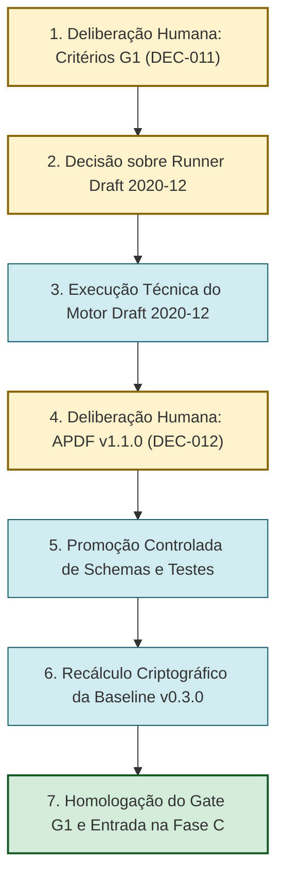

# Plano de Consolidação, Homologação do Gate G1 e Preparação da Fase C

**ID:** PLN-G1-CONSOLIDACAO-001  
**Tipo:** Plano Integrado de Consolidação de Fase, Transição de Gate e Promoção Controlada  
**Versão:** 1.0.0  
**Data:** 2026-10-27  
**Estado:** PROPOSTO — Submetido para deliberação do Proprietário Humano  
**Projeto:** PDI — Núcleo Central de Engenharia  
**Repositório:** `1305RGP/PDI` (branch `main`, commit `bc457538209491d52fe128d5184117d547906d3a`)  
**Autor:** Agente Gemini (IA de Auditoria e Governança)  
**Agentes Colaboradores:** Agente GPT (Modelagem e Testes) e Agente DeepSeek (Metodologia APDF)  
**Autoridade de Aprovação:** Proprietário Humano do Núcleo (designação nominal pendente conforme `GOV-AUTH-001`)

---

## 1. Objetivo e Escopo do Plano

Este plano estabelece a sequência executiva ordenada e coordenada entre os três agentes e o Proprietário Humano para sanar as pendências identificadas na auditoria de governança, formalizar os critérios de aceite do Gate G1, executar a validação técnica conclusiva e realizar a promoção controlada dos artefatos da Fase B para a baseline normativa do projeto, pavimentando a entrada na Fase C.

O plano abrange:
1. **Governança:** Formalização dos critérios de aceite de G1 (`DEC-011`) e deliberação sobre o APDF v1.1.0 (`DEC-012`).
2. **Ambiente Técnico:** Estratégia autorizada para execução do motor JSON Schema Draft 2020-12.
3. **Engenharia:** Promoção controlada dos 10 schemas e fixtures candidatos de `temp/lote-02-gpt/` para `specs/` e `tests/`.
4. **Integridade da Baseline:** Atualização do manifesto criptográfico para a baseline `v0.3.0`.
5. **Transição de Ciclo:** Encerramento do Gate G1 e autorização da Fase C (Harness e Ambiente Antigravity).

---

## 2. Dependências e Matriz de Responsabilidades

### 2.1 Papéis e Atores
- **`PROP-HUMANO`:** Proprietário Humano do Núcleo. Detém a autoridade exclusiva e soberana de aprovação de decisões (`DEC-NNN`), homologação de gates (`G0`, `G1`, `G2`) e autorização de comandos de ambiente/instalação (`GOV-AUTH-001`).
- **`GEMINI`:** Agente de Auditoria, Governança e Rastreabilidade Criptográfica. Responsável pela emissão de pareceres, elaboração de minutas de decisão, verificação de manifesto e auditoria de baseline.
- **`GPT`:** Agente de Engenharia de Schemas, Fixtures e Testes Automatizados. Responsável pela especificação técnica em JSON Schema Draft 2020-12, fixtures de conformidade e runners de teste.
- **`DEEPSEEK`:** Agente de Engenharia Metodológica e Processos. Responsável pelo padrão APDF, matrizes de rastreabilidade de descoberta e saneamento de lacunas metodológicas.

### 2.2 Diagrama de Precedência das Ações

---

## 3. Lista Única de Ações de Consolidação

| Ordem | Código da Ação | Descrição Operacional da Tarefa | Responsável | Dependência Prévia | Critério de Aceite / Evidência Esperada |
|---|---|---|---|---|---|
| **1** | `ACT-G1-01` | **Formalizar os Critérios de Aceite de G1:** Homologar formalmente no [registro-de-decisoes.md](file:///e:/documentos/projetos/PDI/docs/00-governanca/registro-de-decisoes.md) a decisão `DEC-011`, estabelecendo os critérios `CA-G1-01` a `CA-G1-06` conforme minuta no patch candidato. | `PROP-HUMANO` | Parecer da auditoria [ENTREGA_G1_GEMINI_AUDITORIA.md](file:///e:/documentos/projetos/PDI/temp/ENTREGA_G1_GEMINI_AUDITORIA.md) | `DEC-011` registrado com status `APPROVED`; critérios formalmente referenciáveis na governança. |
| **2** | `ACT-G1-02` | **Autorizar Estratégia de Validação Draft 2020-12:** O Proprietário Humano deve deliberar sobre como fechar a validação semântica oficial: Opção A: autorizar comando não persistente `npx ajv-cli` pontual; ou Opção B: considerar a suíte nativa PowerShell de 44 PASS como suficiente para o encerramento da modelagem da Fase B. | `PROP-HUMANO` | `ACT-G1-01` | Autorização expressa registrada no log da sessão ou em decisão. |
| **3** | `ACT-G1-03` | **Executar Validação Semântica Conclusiva:** Caso autorizada a Opção A, executar a validação estrita dos 10 schemas e fixtures contra os meta-schemas oficiais do Draft 2020-12. | `GPT` | `ACT-G1-02` | Relatório de execução com saída de validação semântica anexada e 0 erros. |
| **4** | `ACT-G1-04` | **Deliberar sobre a Promoção do APDF v1.1.0:** Avaliar o documento [APDF_V1_1_0_CANDIDATA.md](file:///e:/documentos/projetos/PDI/temp/APDF_V1_1_0_CANDIDATA.md) e seu diff [temp/_diff_g1_v100_para_v101.diff](file:///e:/documentos/projetos/PDI/temp/_diff_g1_v100_para_v101.diff), decidindo sobre a incorporação das correções diferidas (`C-01`, `C-05`, `C-06`, `C-07`, `C-11`) e novos ajustes (`C-12`, `C-13`) via `DEC-012`. | `PROP-HUMANO` | Parecer DeepSeek e proposta candidata | `DEC-012` registrado no registro de decisões com status `APPROVED` ou `REJECTED`. |
| **5** | `ACT-G1-05` | **Promoção Controlada dos Schemas e Testes da Fase B:** Copiar os 10 JSON Schemas de `temp/lote-02-gpt/specs/` para `specs/contratos/` e `specs/schemas/`; copiar as 10 fixtures e o catálogo de testes de `temp/lote-02-gpt/tests/` para `tests/contracts/` e `tests/fixtures/`. Atualizar os respectivos `README.md` das pastas normativas. | `GEMINI` / `GPT` | `ACT-G1-01`, `ACT-G1-03`, `ACT-G1-04` | Arquivos posicionados nas pastas normativas oficiais sem gerar conflito. |
| **6** | `ACT-G1-06` | **Recálculo Integral da Baseline Documental e Criptográfica:** Atualizar `docs/01-metodologia/APDF_V01.md` (caso `DEC-012` seja aprovado); recalcular o SHA-256 de todos os arquivos normativos existentes e adicionados; gerar o [MANIFESTO-SHA256.md](file:///e:/documentos/projetos/PDI/MANIFESTO-SHA256.md) elevado para a versão `0.3.0` (ou `0.2.2`); atualizar [CHANGELOG.md](file:///e:/documentos/projetos/PDI/CHANGELOG.md) e [README.md](file:///e:/documentos/projetos/PDI/README.md). | `GEMINI` | `ACT-G1-05` | 100% dos arquivos normativos conferidos via `verify.ps1` com 0 divergências. |
| **7** | `ACT-G1-07` | **Homologação Formal do Gate G1 e Desbloqueio da Fase C:** Emitir ato formal declarando o Gate G1 homologado e concluído, e autorizando a transição do projeto para a **Fase C (Verificação no ambiente Antigravity, Harness e Capacidades de Ferramentas)**. | `PROP-HUMANO` | `ACT-G1-06` | Ato registrado formalmente em `DEC-011` / `DEC-013` e `README.md`. |
| **8** | `ACT-G1-08` | **Saneamento e Arquivamento de Artefatos Temporários Superados:** Mover relatórios e arquivos temporários de versões anteriores em `temp/` para arquivo histórico compactado, mantendo `temp/` limpo e rastreável. | `GEMINI` | `ACT-G1-07` | Diretório `temp/` organizado e sem artefatos obsoletos soltos. |

---

## 4. Plano de Rollback e Contingência

Caso ocorra qualquer não conformidade durante a promoção controlada (`ACT-G1-05` ou `ACT-G1-06`):
1. **Ponto de Restauração (Checkpoint):** O commit canônico `bc457538209491d52fe128d5184117d547906d3a` é a referência estável e imutável da baseline `v0.2.1`.
2. **Procedimento de Reversão:**
   - Comandar `git checkout main` e `git reset --hard bc457538209491d52fe128d5184117d547906d3a`.
   - Como os arquivos candidatos residem em `temp/` (que é untracked), a reversão preserva integralmente todo o trabalho preliminar em `temp/` sem perda de dados.
3. **Bloqueio de Propagação:** Nenhuma modificação é enviada ao repositório remoto GitHub (`origin/main`) antes da confirmação inequívoca de 100% de integridade no script `verify.ps1`.

---

## 5. Próximos Passos Imediatos para o Usuário

Para dar prosseguimento ao plano, recomenda-se ao Proprietário Humano:
1. Revisar o parecer de auditoria em [ENTREGA_G1_GEMINI_AUDITORIA.md](file:///e:/documentos/projetos/PDI/temp/ENTREGA_G1_GEMINI_AUDITORIA.md);
2. Avaliar a minuta de decisão `DEC-011` proposta em [PATCH_CANDIDATO_GOVERNANCA_G1.md](file:///e:/documentos/projetos/PDI/temp/PATCH_CANDIDATO_GOVERNANCA_G1.md);
3. Deliberar formalmente sobre a formalização dos critérios de G1 e autorizar a etapa executiva de validação e promoção da Fase B.
