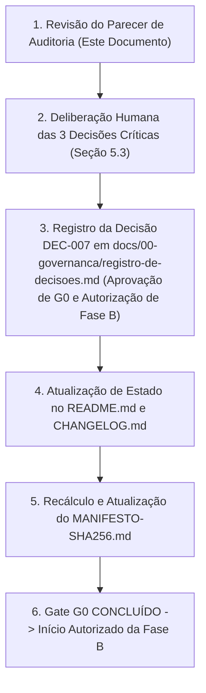

# Parecer de Auditoria da Baseline e Prontidão para o Gate G0

**ID:** REL-GEMINI-AUD-G0-001  
**Tipo:** Parecer Técnico de Auditoria e Prontidão de Gate  
**Data:** 2026-10-26  
**Versão do Projeto:** 0.1.0  
**Status:** CONCLUÍDO (Auditoria realizada; deliberação do Gate G0 reservada à autoridade humana)  
**Executor Designado:** Gemini (modelo de inspeção estrita somente leitura)  
**Escopo:** Auditoria de conformidade da baseline documental v0.1.0, governança, contratos 01 a 05, consistência de estados e análise de bloqueadores para o Gate G0.  
**Instrução de Origem:** [`temp/LOTE_GEMINI_AUDITORIA_G0.md`](file:///E:/documentos/projetos/PDI/temp/LOTE_GEMINI_AUDITORIA_G0.md)  

---

## 1. Resumo Executivo

Esta auditoria inspecionou a baseline documental v0.1.0 do **Núcleo Central de Engenharia (PDI)** para determinar as condições objetivas de encerramento do **Gate G0 (Revisão da Materialização Documental)**. 

Principais conclusões:
1. **Materialização documental 100% íntegra:** Todos os 26 arquivos controlados previstos na baseline existem, possuem metadados padronizados e conferem 100% com os hashes de [`MANIFESTO-SHA256.md`](file:///E:/documentos/projetos/PDI/MANIFESTO-SHA256.md).
2. **Separação conceitual vs executável:** A baseline v0.1.0 é puramente normativa e especificativa. Não há código, schemas executáveis ou testes automatizados implementados (`specs/` e `tests/` contêm apenas READMEs descritivos). Isso é compatível com o escopo de G0, desde que não seja confundido com conformidade operacional.
3. **DEC-003 preservada e coerente:** A neutralidade arquitetural (não imposição de Clean Architecture, DDD ou EDA universais) está plenamente alinhada à Norma Central (`NCE-001`) e ao catálogo de ADRs (`docs/03-adrs/`).
4. **Prontidão do Gate G0:** O Gate G0 **não pode ser declarado aprovado por agentes ou IAs**, dependendo exclusivamente de deliberação humana formal do Proprietário do Núcleo. Três decisões humanas centrais desbloqueiam G0 imediatamente.

---

## 2. Evidências e Arquivos Consultados

A auditoria inspecionou diretamente os seguintes artefatos em disco, cruzando com os relatórios prévios da área transitória:

| ID / Caminho | Tipo / Função | Hash SHA-256 Verificado | Estado Documental Declarado |
|---|---|---|---|
| [`AGENTS.md`](file:///E:/documentos/projetos/PDI/AGENTS.md) | Regras operacionais de agentes | `ece5d54137f630ee5aa863e6f5c67a5ca644732e8dce05bb09e8e56f3ff472a6` | Normativo vigente |
| [`README.md`](file:///E:/documentos/projetos/PDI/README.md) | Visão geral do Núcleo (`PDI-ROOT-README`) | `c0b70ca143b22011e1873ee1611c06f42ed8dd64ce8fd99d4491304f33ec94c7` | `APPROVED` (conceitual) |
| [`CHANGELOG.md`](file:///E:/documentos/projetos/PDI/CHANGELOG.md) | Histórico de versões (`PDI-CHANGELOG`) | `0e4e75896cb95aa9402b4730e43a1380242681d4040a9cd7627a245d5b221ca4` | Normativo vigente |
| [`MANIFESTO-SHA256.md`](file:///E:/documentos/projetos/PDI/MANIFESTO-SHA256.md) | Manifesto de integridade criptográfica | `b1e220ba3fb915e6bfaae673410fa406ea9e1a10fb6e133f98c41ec31379bb50` | Normativo vigente |
| [`docs/00-governanca/norma-central.md`](file:///E:/documentos/projetos/PDI/docs/00-governanca/norma-central.md) | Norma Central de Engenharia (`NCE-001`) | `915ea03bee86c14a06af2655a8dc35ba2e0a6959e449e41774a2587a5236dfdf` | `APPROVED` (conceitual) |
| [`docs/00-governanca/hierarquia-documental.md`](file:///E:/documentos/projetos/PDI/docs/00-governanca/hierarquia-documental.md) | Hierarquia e precedência (`GOV-DOC-001`) | `4b9a23cdc8bc3352a5542ac2b2dca61bc068bf06427e9ee5f99f648ce43f10c2` | `APPROVED` (conceitual) |
| [`docs/00-governanca/matriz-de-autoridade.md`](file:///E:/documentos/projetos/PDI/docs/00-governanca/matriz-de-autoridade.md) | Matriz de autoridade e papéis (`GOV-AUTH-001`) | `a8119c2f7926d565987caa9f524d69f3d46d77f46638c3260ea71a21c1c17af1` | `APPROVED` (conceitual) |
| [`docs/00-governanca/registro-de-decisoes.md`](file:///E:/documentos/projetos/PDI/docs/00-governanca/registro-de-decisoes.md) | Decisões DEC-001 a DEC-006 (`GOV-DEC-001`) | `1ab612db081beeabfd4f5fc991641403a9d22eac657759848a54c143045ce4ea` | Controlado / Ativo |
| [`docs/01-metodologia/apdf.md`](file:///E:/documentos/projetos/PDI/docs/01-metodologia/apdf.md) | Processo APDF provisório (`MET-APDF-001`) | `db5fbf1ec16c329eb8c8e0435eb317bbd7ab2d460539b847d08de489da28cb15` | `DRAFT` (provisório) |
| [`docs/01-metodologia/ciclo-apdf.md`](file:///E:/documentos/projetos/PDI/docs/01-metodologia/ciclo-apdf.md) | Ciclo de execução (`MET-CICLO-001`) | `75cf2e28e9579463a7f2f1210dc37a4d0ff0d90bae257e9fe023e8704259e612` | `DRAFT` (provisório) |
| [`docs/01-metodologia/anti-surto.md`](file:///E:/documentos/projetos/PDI/docs/01-metodologia/anti-surto.md) | Mecanismo Anti-Surto (`MET-SURTO-001`) | `e8d6dd8be893e82c6281b46f4e2b1da71c2bafb0354b179a5b4b6586c2bbb7f8` | `APPROVED` (conceitual) |
| [`docs/02-contratos/contrato-01-governanca.md`](file:///E:/documentos/projetos/PDI/docs/02-contratos/contrato-01-governanca.md) | Contrato 01 — Governança (`CTR-01`) | `9660d11b6ef03737173d367505cff70cf0fa2f476a57fcd8ad70bc3d568357cf` | `APPROVED` (conceitual) |
| [`docs/02-contratos/contrato-02-qualidade.md`](file:///E:/documentos/projetos/PDI/docs/02-contratos/contrato-02-qualidade.md) | Contrato 02 — Qualidade/Evidências (`CTR-02`) | `2aefc78d5405227f591257eec15f857612a1bc5483e307da77a556eff19e9934` | `APPROVED` (conceitual) |
| [`docs/02-contratos/contrato-03-harness.md`](file:///E:/documentos/projetos/PDI/docs/02-contratos/contrato-03-harness.md) | Contrato 03 — Harness/Loops (`CTR-03`) | `70ba80e3ceac6a82da417aca03930fc1e6a5b9369906f6909eca850f1c8c28f9` | `APPROVED` (conceitual) |
| [`docs/02-contratos/contrato-04-orquestracao.md`](file:///E:/documentos/projetos/PDI/docs/02-contratos/contrato-04-orquestracao.md) | Contrato 04 — Ferramentas/Orquestração (`CTR-04`) | `08a01f932268a1454f0fba24b19db2b37c01fc64d578f68c0e336ddd19b6ed5f` | `APPROVED` (conceitual) |
| [`docs/02-contratos/contrato-05-inicializacao.md`](file:///E:/documentos/projetos/PDI/docs/02-contratos/contrato-05-inicializacao.md) | Contrato 05 — Inicialização/Evolução (`CTR-05`) | `0b51d95877889f489e55140eaa9294e416136e2ca8bc0034a9305413ed53938a` | `APPROVED` (conceitual) |
| [`docs/03-adrs/README.md`](file:///E:/documentos/projetos/PDI/docs/03-adrs/README.md) | Diretrizes para ADRs (`ADR-README-001`) | `5f0ff058d1f2e2dfe47764e5839a1d882fd9cbf4bb615cb1102bcd4c0be738bd` | `APPROVED` |
| [`docs/04-qualidade/criterios-de-aceite.md`](file:///E:/documentos/projetos/PDI/docs/04-qualidade/criterios-de-aceite.md) | Critérios Gerais de Aceite (`QUA-CRIT-001`) | `a6ada98d5abe5ca91630d3512f8247dd4d297ce9642022be595c8a685ef77942` | `APPROVED` (conceitual) |
| [`docs/04-qualidade/plano-de-validacao.md`](file:///E:/documentos/projetos/PDI/docs/04-qualidade/plano-de-validacao.md) | Plano de Validação (`QUA-VAL-001`) | `c2386bee8c8322dc3f627403108c7f129b1c8ec843a03357b160aaf1076cadfd` | `PENDING_APPROVAL` |
| [`docs/05-ferramentas/inventario.md`](file:///E:/documentos/projetos/PDI/docs/05-ferramentas/inventario.md) | Inventário de Ferramentas (`FER-INV-001`) | `edc34e6c2521130dbccc49ccbd598bedc89840529d003977aa3a9fb3960c5e92` | `DRAFT` |
| [`docs/05-ferramentas/matriz-de-compatibilidade.md`](file:///E:/documentos/projetos/PDI/docs/05-ferramentas/matriz-de-compatibilidade.md) | Compatibilidade de Ferramentas (`FER-COMP-001`) | `b5fd9ebe581a7d29b0ba9f78321cc224d90027558606e659635b2ef61a0f957b` | `DRAFT` |
| [`docs/06-evidencias/README.md`](file:///E:/documentos/projetos/PDI/docs/06-evidencias/README.md) | Repositório de Evidências (`EVI-README-001`) | `c45cc6800eaa03647b56e951924fbb9d086d1f921fe09df4672a8ef0f89b74ed` | `APPROVED` |
| Pastas de specs (`specs/contratos/`, `specs/schemas/`) | Estrutura de especificações executáveis | Verificado via manifesto | `DRAFT` |
| Pastas de testes (`tests/contracts/`, `evaluations/`, `governance/`) | Estrutura de cadernos de testes | Verificado via manifesto | `DRAFT` |
| Artefatos em [`temp/`](file:///E:/documentos/projetos/PDI/temp/) | Área de intercâmbio de relatórios | Não normativo (fora do manifesto) | `OPERACIONAL` |

---

## 3. Consistência da Baseline e Análise de Estados

### 3.1 Estados Canônicos vs Estados Compostos
A regra [`GOV-DOC-001#L52`](file:///E:/documentos/projetos/PDI/docs/00-governanca/hierarquia-documental.md#L52) define os 8 estados documentais válidos:
$$\text{Estados Canônicos} = \{\text{DRAFT, IN\_REVIEW, PENDING\_APPROVAL, CHANGES\_REQUESTED, APPROVED, REJECTED, SUPERSEDED, OBSOLETE}\}$$

**Constatação de inconsistência sintática:**  
Diversos artefatos utilizam strings compostas no cabeçalho `Estado:`, tais como:
- `APPROVED — conceitualmente; materialização documental inicial; implementação dos controles pendente.` (`README.md`)
- `APPROVED — conceitualmente; implementação técnica pendente.` (`CTR-01` a `CTR-05`)
- `DRAFT — referência provisória não homologada.` (`MET-APDF-001`)
- `PENDING_APPROVAL — planejado; execução pendente.` (`QUA-VAL-001`)

**Impacto:** Em validadores automatizados (como schemas JSON de metadados na Fase B), a validação por enum estrito falhará se o campo `Estado` contiver comentários semânticos anexados.  
**Recomendação:** No fechamento de G0 ou abertura da Fase B, isolar o enum no valor canônico (`APPROVED`, `DRAFT`, `PENDING_APPROVAL`) e mover a observação descritiva para o campo `Histórico de aprovação` ou `Observações`.

### 3.2 Rigorosa Distinção: Especificado × Implementado × Executado × Validado
Conforme imposto por [`AGENTS.md#L21`](file:///E:/documentos/projetos/PDI/AGENTS.md#L21) e [`CTR-05#L26`](file:///E:/documentos/projetos/PDI/docs/02-contratos/contrato-05-inicializacao.md#L26):

| Dimensão | Estado Atual na Baseline v0.1.0 | Evidência Documental |
|---|---|---|
| **Especificado** | **100% Concluído** para v0.1.0 | 26 arquivos normativos cobrindo governança, metodologia, contratos e guias. |
| **Implementado** | **0% Implementado** | Diretórios `specs/schemas/`, `specs/contratos/` contêm apenas arquivos `README.md`. Não há código de automação, scripts ou regras MCP/hooks criadas. |
| **Executado** | **0% Executado** (em termos de testes automatizados de controle) | Pastas em `tests/` contêm apenas arquivos `README.md`. Nenhum caso de teste foi rodado. |
| **Validado** | **Fase A (Documental) Validada; Fase B/C Pendentes** | A integridade textual, links e SHA-256 foram validados na Fase A. A conformidade funcional de contratos permanece não validada. |

---

## 4. Análise de Coerência da Decisão DEC-003

A decisão `DEC-003` estabelece formalmente em [`registro-de-decisoes.md#L10`](file:///E:/documentos/projetos/PDI/docs/00-governanca/registro-de-decisoes.md#L10):
> *"O Núcleo padroniza controles, não uma arquitetura única para todos os produtos. Arquitetura local deve ser justificada por ADR."*

### Confronto com a Norma Central e Documentos Conexos:
1. **Norma Central (`NCE-001`):** A Seção 1 (`NCE-001#L10`) declara expressamente: *"A norma não impõe uma arquitetura de produto ou stack tecnológica universal."* O Princípio 10 (`NCE-001#L23`) reitera: *"Arquitetura adequada ao contexto: padrões arquiteturais são escolhidos com justificativa, não impostos automaticamente."* (Coerência absoluta).
2. **Instruções Gerais (`AGENTS.md`):** Na seção Arquitetura (`AGENTS.md#L37`), é expressamente vedado: *"Não impor Clean Architecture, DDD, Event-Driven Architecture ou stack específica a todos os produtos sem necessidade demonstrada e decisão registrada."* (Alinhamento integral).
3. **Catálogo de ADRs (`docs/03-adrs/README.md`):** O Nível 4 da hierarquia prevê que toda decisão estrutural local pertence a um Architecture Decision Record (ADR), vinculando qualquer exceção ou adoção tecnológica ao projeto que a demanda.
4. **Resolução de Tensões com Fontes Externas:** A documentação externa de produto (*AI Innovation OS*) trazia especificações rígidas de Clean Architecture e EDA. A proposta de adaptação do APDF (`MET-APDF-ADAPT-001`, item `ADP-011`) manteve a subordinação correta: o APDF orienta a descoberta técnica, mas a arquitetura final é congelada via ADRs do projeto e não por prescrição a priori do núcleo.

**Conclusão da Auditoria:** `DEC-003` não apresenta nenhuma incoerência ou contradição com o corpo normativo. Deve ser mantida sem alterações.

---

## 5. Matriz de Bloqueadores e Pendências do Gate G0

Classificação por natureza ontológica da informação:

### 5.1 Bloqueadores Críticos Reais para o Gate G0
Estes itens impedem a declaração formal de aprovação do Gate G0:

| ID | Bloqueador | Evidência Documental | Natureza | Impacto / Resolução |
|---|---|---|---|---|
| **BLK-G0-01** | **Ausência de Homologação Formal Humana** | [`README.md#L49`](file:///E:/documentos/projetos/PDI/README.md#L49); [`norma-central.md#L15`](file:///E:/documentos/projetos/PDI/docs/00-governanca/norma-central.md#L15); [`AGENTS.md#L24`](file:///E:/documentos/projetos/PDI/AGENTS.md#L24) | **Decisão Humana Necessária** | Agentes de IA estão terminantemente proibidos de aprovar o próprio gate ou homologar a baseline. Exige declaração explícita do proprietário humano. |
| **BLK-G0-02** | **Definição de Fronteira do APDF na Baseline** | [`docs/01-metodologia/apdf.md#L6`](file:///E:/documentos/projetos/PDI/docs/01-metodologia/apdf.md#L6); [`temp/parecer-revisao-adaptacao-apdf.md`](file:///E:/documentos/projetos/PDI/temp/parecer-revisao-adaptacao-apdf.md) | **Evidência Documental + Decisão Humana** | O `apdf.md` está em `DRAFT` provisório. Para fechar G0, o humano deve decidir se: **(Opção 1)** Aprova G0 mantendo o APDF como DRAFT provisório (descoberta autorizada, sem conformidade plena), permitindo iniciar a Fase B dos contratos; ou **(Opção 2)** Exige homologar a adaptação do APDF antes de fechar G0. *(Recomendação técnica: Opção 1)*. |
| **BLK-G0-03** | **Assunção Formal da Autoridade do Núcleo** | [`matriz-de-autoridade.md#L9`](file:///E:/documentos/projetos/PDI/docs/00-governanca/matriz-de-autoridade.md#L9); [`norma-central.md#L42`](file:///E:/documentos/projetos/PDI/docs/00-governanca/norma-central.md#L42) | **Decisão Humana Necessária** | A designação nominal de equipe técnica/segurança é pendência de onboarding (`GOV-AUTH-001#L43`), mas para G0 o usuário atual deve atuar explicitamente como "Proprietário Humano do Núcleo". |

---

### 5.2 Pendências Resolvíveis em Lote (Sem Bloqueio de G0)
Pendências técnicas ou editoriais que podem ser acolhidas em uma única batelada de ajustes antes ou durante a Fase B:

| ID | Descrição | Evidência Documental | Natureza | Tratamento Proposto |
|---|---|---|---|---|
| **PEN-LOT-01** | **Normalização de Enums de Estado:** Extrair comentários explicativos do cabeçalho `Estado:`, deixando apenas o enum canônico (`APPROVED`, `DRAFT`, `PENDING_APPROVAL`). | [`hierarquia-documental.md#L52`](file:///E:/documentos/projetos/PDI/docs/00-governanca/hierarquia-documental.md#L52) | Evidência Documental | Ajuste em lote nas especificações de metadados na Fase B. |
| **PEN-LOT-02** | **Harmonização de Pastas em `tests/`:** Decidir entre manter pastas em inglês (`contracts/`, `evaluations/`, `governance/`) ou alinhar ao padrão de `docs/` (`contratos/`). | [`tests/contracts/README.md`](file:///E:/documentos/projetos/PDI/tests/contracts/README.md) | Inferência técnica | Resolver conceitualmente no plano da Fase B sem quebrar links atuais. |
| **PEN-LOT-03** | **Atualização do Status de Referências em `temp/revisao-referencias.md`:** Marcar fontes como recuperadas e analisadas. | [`temp/revisao-referencias.md`](file:///E:/documentos/projetos/PDI/temp/revisao-referencias.md) | Evidência Documental | Atualização restrita à pasta `temp/`. |

---

### 5.3 Decisões Exclusivas que Só a Autoridade Humana Pode Tomar
1. **Aprovação do Gate G0:** Declarar formalmente que a materialização documental v0.1.0 atende à baseline conceitual aprovada em DEC-001 a DEC-006.
2. **Autorização de Início da Fase B:** Autorizar expressamente o início da criação dos schemas JSON formais em `specs/schemas/` e `specs/contratos/` e a elaboração dos cadernos de testes automatizados em `tests/`.
3. **Ratificação da Neutralidade Arquitetural (DEC-003):** Confirmar que implementações de produto utilizarão ADRs e que o núcleo padroniza apenas a governança e o harness de controle.

---

## 6. Itens que NÃO Impedem o Gate G0 (Escopo da Fase B ou Posterior)

Com o objetivo de evitar paralisia por análise e confusão de escopo, a auditoria certifica que os seguintes itens **não são bloqueadores do Gate G0**:

1. **Implementação de Schemas JSON:** Schemas formais para validação de metadados e contratos pertencem integralmente à Fase B (previstos no Contrato 05 e Plano de Validação).
2. **Implementação e Execução de Testes Automatizados:** Controles e harnesses automatizados pertencem à Fase B. O G0 atesta a *especificação*, não a *execução técnica*.
3. **Instalação de Ferramentas, Dependências e Conexão de Repositórios:** A proibição de ferramentas externas (DEC-004 e DEC-006) é mandatória em G0. A validação de ambiente (Fase C) ocorrerá posteriormente.
4. **Homologação Plena do APDF:** O APDF já possui regra operacional transitória que autoriza seu uso como guia de descoberta em estado `DRAFT`, vedando apenas a declaração de conformidade integral. A finalização da matriz de adaptação pelo lote do DeepSeek pode tramitar em paralelo sem bloquear a aprovação da baseline de governança do PDI.

---

## 7. Sequência Mínima para Fechar o Gate G0

Para declarar o Gate G0 formalmente encerrado com total conformidade com a Norma Central de Engenharia, basta executar o seguinte rito sequencial:

1. **Passo 1 (Humano):** O usuário (Proprietário do Núcleo) declara formalmente aprovado o Gate G0 e autoriza a entrada na Fase B com a baseline atual (mantendo o APDF provisório e a arquitetura neutra via DEC-003).
2. **Passo 2 (Operacional):** Registrar `DEC-007` no [`docs/00-governanca/registro-de-decisoes.md`](file:///E:/documentos/projetos/PDI/docs/00-governanca/registro-de-decisoes.md) formalizando o aceite de G0.
3. **Passo 3 (Operacional):** Atualizar o cabeçalho de [`README.md`](file:///E:/documentos/projetos/PDI/README.md) e [`CHANGELOG.md`](file:///E:/documentos/projetos/PDI/CHANGELOG.md) registrando a conclusão do Gate G0.
4. **Passo 4 (Operacional):** Recalcular os hashes dos arquivos modificados em [`MANIFESTO-SHA256.md`](file:///E:/documentos/projetos/PDI/MANIFESTO-SHA256.md).
5. **Passo 5 (Operacional):** Desbloquear formalmente a Fase B para início do lote técnico do GPT (`specs/` e `tests/`).

---

## 8. Parecer Conclusivo da Auditoria

- **Estado Documental Atual:** **CONFORME E PRONTO PARA HOMOLOGAÇÃO.**
- **Violações Críticas de Governança na Baseline:** **NENHUMA IDENTIFICADA.**
- **Próxima Ação Requerida:** Submissão do parecer à deliberação soberana do Proprietário Humano do Núcleo para formalização do Gate G0.
